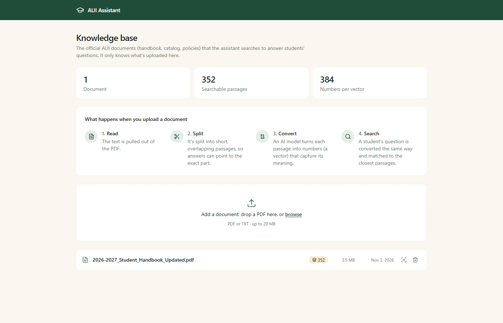
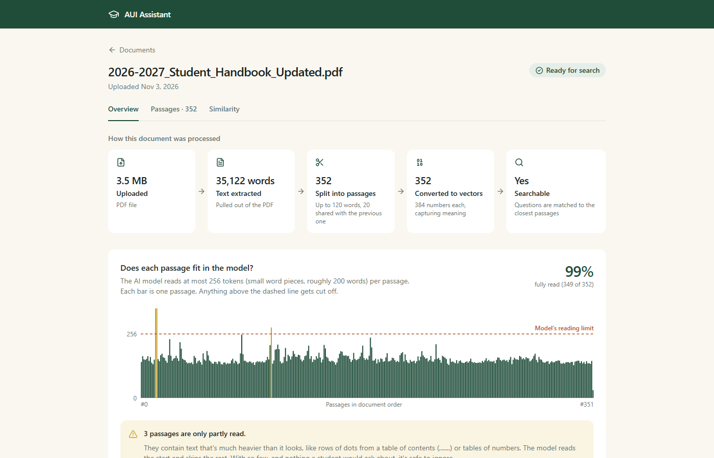

# AUI Assistant

Ask a question about Al Akhawayn University's policies, courses or campus life, and get an answer grounded in the official AUI documents, with the source passages shown.

AUI's official information (catalog, student handbook, policies, academic calendar) is spread across dozens of PDFs. AUI Assistant turns those PDFs into a searchable knowledge base and answers students' questions with retrieval-augmented generation (RAG). The retrieval layer is a **Hierarchical Navigable Small World (HNSW) vector index implemented from scratch**, validated against brute-force search and benchmarked against FAISS. A built-in evaluation view measures retrieval quality (recall@k, MRR).

Full product requirements: [docs/PRD.md](docs/PRD.md).

| Knowledge base | Document inspector |
|---|---|
|  |  |

## Status

Personal project in active development, started October 2026.

| Milestone | Scope | Status |
|---|---|---|
| M0 | Full stack runs locally (React, Express, FastAPI, Postgres) | Done |
| M1 | Ingestion: upload → extract text → chunk → embed → store | Done |
| | Document inspector (chunk, token and embedding diagnostics) | Done |
| M2 | Retrieval with FAISS + student chat UI | In progress (semantic search and the Ask page work; LLM answers and chat next) |
| M3 | HNSW from scratch replaces FAISS | Planned |
| M4 | Evaluation view (recall@k, MRR) | Planned |
| M5 | HNSW vs FAISS benchmark | Planned |
| M6 | Configuration study with Benjamini–Hochberg correction | Planned |
| M7 | Public deployment | To do (database ready) |

**Not built yet:** answers written by an LLM, the multi-turn chat, HNSW, evaluation and deployment. Today the app ingests documents and finds the passages closest to a question, but it doesn't write an answer yet, and retrieval quality hasn't been measured yet.

**Deployment plan (to do):**
- [x] PostgreSQL on Neon, migrations applied
- [ ] ML service on a free host. Free tiers give about 512 MB of memory, which PyTorch exceeds, so the plan is to serve the same all-MiniLM-L6-v2 model through ONNX (`fastembed`) instead
- [ ] API and web app on Vercel
- [ ] Read-only mode for the public demo, so visitors can't upload or delete documents

## Architecture

```
 Browser (React + Vite + Tailwind)
        │  HTTP / JSON
        ▼
 API server (Node.js, Express, Prisma)  ──────►  PostgreSQL
        │  HTTP / JSON                           documents, chunks, embeddings
        ▼
 ML service (Python, FastAPI, sentence-transformers)
    /embed      text → 384-dim normalized vectors (all-MiniLM-L6-v2)
    /tokenize   exact token counts from the model's own tokenizer
    /search     k closest chunks for a vector (FAISS, exact search, in memory)
    /reindex    rebuilds the index from Postgres after chunks change
```

- **API server** (`api/`): handles uploads, PDF text extraction, chunking, and all database access through Prisma. It calls the ML service over HTTP.
- **ML service** (`ml/`): a Python service, because the embedding model, FAISS and the HNSW index all live in the Python ecosystem. It loads the model once at startup, embeds a whole document's chunks in one batched request, and keeps the search index in memory, built from Postgres.
- **Web** (`web/`): an Ask page (semantic search), a knowledge-base page (upload, list, delete), and an inspector that shows how each document was processed.

### Ingestion pipeline

1. **Upload:** a PDF or text file (up to 20 MB) is received in memory with multer.
2. **Extract:** the text is pulled out of the PDF. Scanned PDFs are rejected because they contain no text.
3. **Chunk:** the text is split into 120-word passages, each repeating the last 20 words of the previous one, so no sentence is lost at a boundary.
4. **Embed:** all passages go to the ML service in one request and come back as 384-number vectors, normalized so cosine similarity is a dot product.
5. **Store:** the document and its passages are written in a single Postgres transaction, after the slow embedding call has finished.

### Search pipeline

1. **Count tokens:** the text is measured with the model's own tokenizer.
2. **Chunk only if needed:** a question fits the model, so it's embedded whole. Text past the 256-token limit is split with the same chunker as documents, because the model would otherwise ignore everything after the limit.
3. **Embed:** the same model as ingestion, because vectors from different models can't be compared.
4. **Search:** FAISS compares each vector with every stored passage (exact search). When a long text was split, a passage keeps its best score across the parts.
5. **Return:** Express looks up the winning chunk IDs in Postgres and adds the text and the document name.

Postgres stays the source of truth and the FAISS index is a copy of it in memory, so every upload, re-process and delete triggers a rebuild.

## Engineering notes

**Chunk size was chosen by measurement, not by rule of thumb.** The embedding model reads at most 256 tokens and silently ignores the rest. The usual estimate (≈1.3 tokens per word) said 200-word chunks were safe, but counting with the model's own tokenizer on real AUI documents showed otherwise. Course codes such as `CSC 4352` cost about 1.5 tokens per word.

| Chunk size | Student handbook: chunks cut off | Course catalog: chunks cut off |
|---|---|---|
| 200 words | 84 of 220 (38%) | 7 of 9 |
| **120 words** (current) | **3 of 352 (0.9%)** | **0 of 14** |

The 3 remaining handbook chunks are rows of table-of-contents dots and an opening-hours table, which contain nothing a student would ask about.

**The document inspector** exists to catch problems like this. For every document it shows the pipeline results, each chunk's exact token count against the model's limit, the measured overlap, every embedding as a heat strip, and how similar consecutive chunks are. It can re-process a document with the current settings from its stored text.

## Run it locally

Requirements: Node.js 20+, Python 3.11+, PostgreSQL.

**1. Database and API** (port 4000)

```bash
cd api
npm install
cp .env.example .env        # then set DATABASE_URL
npx prisma migrate dev      # creates the tables
npm run dev
```

**2. ML service** (port 8000). The first start downloads the embedding model (about 90 MB).

```bash
cd ml
python -m venv .venv
source .venv/Scripts/activate   # Windows (Git Bash); on macOS/Linux: source .venv/bin/activate
pip install -r requirements.txt
cp .env.example .env            # then set DATABASE_URL, the same database as the API
uvicorn main:app --reload --port 8000
```

**3. Web app** (port 5173)

```bash
cd web
npm install
npm run dev
```

Open http://localhost:5173, upload a PDF, then search it from the Ask page. `GET http://localhost:4000/api/health` reports whether the API and the ML service are both up.

## API

| Method | Endpoint | What it does |
|---|---|---|
| `GET` | `/api/health` | Health of the API and the ML service |
| `POST` | `/api/search` | Find the closest passages (JSON: `query`, optional `k`), and report how the text was processed |
| `POST` | `/api/upload` | Upload a PDF or text file (form field `file`): extract, chunk, embed, store |
| `GET` | `/api/documents` | List documents with their chunk counts |
| `GET` | `/api/documents/:id` | Short summary of one document |
| `GET` | `/api/documents/:id/inspect` | Full diagnostics: chunks, exact token counts, overlap, embeddings, similarity |
| `POST` | `/api/documents/:id/reprocess` | Re-chunk and re-embed a document from its stored text |
| `DELETE` | `/api/documents/:id` | Delete a document and, by cascade, its chunks |

ML service: `POST /embed` and `POST /tokenize` take `{ "texts": [...] }`, `POST /search` takes `{ "vectors": [...], "k": 5 }`, and `POST /reindex` rebuilds the index. Interactive docs are at http://localhost:8000/docs.

## Project structure

```
api/    Express + Prisma API (routes → controllers → services)
ml/     FastAPI embedding and search service
web/    React + Vite + Tailwind frontend
docs/   Product requirements (PRD.md)
```

## Tech stack

TypeScript, React 19, Vite, Tailwind CSS · Node.js, Express 5, Prisma 6, multer, pdf-parse · PostgreSQL · Python, FastAPI, sentence-transformers (all-MiniLM-L6-v2), FAISS. Coming in M3: an HNSW index written from scratch.
